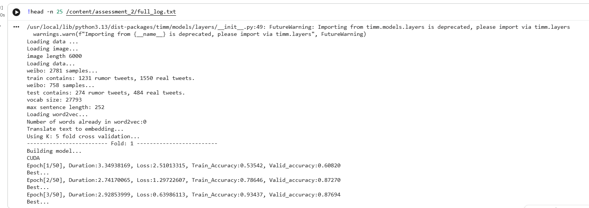
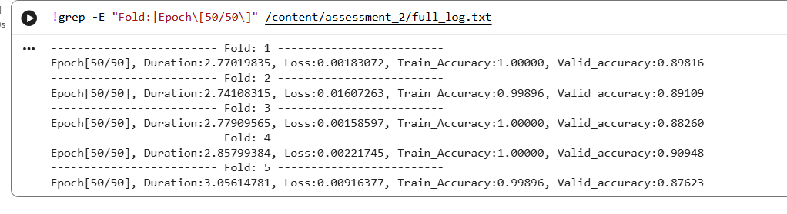
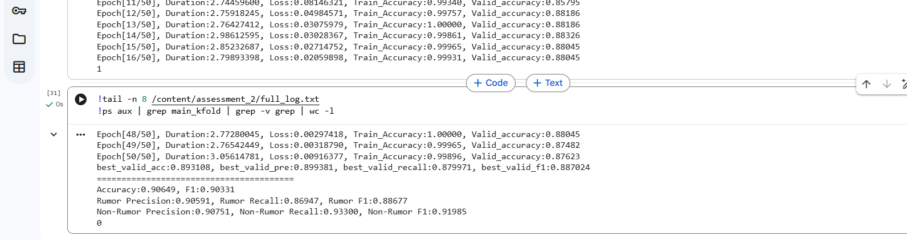

# FSRU
This is the PyTorch implementation of AAAI 2024 paper "Frequency Spectrum is More Effective 
for Multimodal Representation and Fusion: A Multimodal Spectrum Rumor Detector".

by _AN Lao, Qi Zhang, Chongyang Shi, Longbing Cao, Kun Yi, Liang Hu, Duoqian Miao_


## Dataset
* [Weibo](https://drive.google.com/file/d/14VQ7EWPiFeGzxp3XC2DeEHi-BEisDINn/view)
* [Twitter (mediaeval)](https://github.com/MKLab-ITI/image-verification-corpus/tree/master/mediaeval2015)

## Dependencies
This code requires the following:
* python == 3.9
* torch == 2.1.1
* torchvision == 0.16.1
* numpy == 1.26.2
* pandas == 2.1.1
* scipy == 1.11.4
* scikit-learn == 1.3.2
* timm == 0.9.12

## Running the experiments
```shell
python main_kfold.py
```
## Execution Results (Aniska Rai, 25BTRAO004)

Ran `main_kfold.py` on the Weibo dataset in Google Colab (T4 GPU), 5-fold cross-validation, 50 epochs per fold.

### Changes made to run it
- The downloaded Weibo data was the raw version (`tweets/*.txt` plus image folders), so I converted it to `train_data.csv` / `test_data.csv` (segmented with jieba), as `data_loader.py` expects.
- No `w2v.pickle` was provided, so I used an empty one; the code then assigns random 32-d word vectors.
- Because of Colab's 12 GB RAM limit, `data_loader.py` loads images in half precision and uses at most 3,000 images per image folder (a subset of the dataset).

### Final results
Accuracy: 0.90649, F1: 0.90331

Rumor: Precision 0.90591, Recall 0.86947, F1 0.88677

Non-Rumor: Precision 0.90751, Recall 0.93300, F1 0.91985

### Screenshots




Full log: [full_log.txt](full_log.txt)
